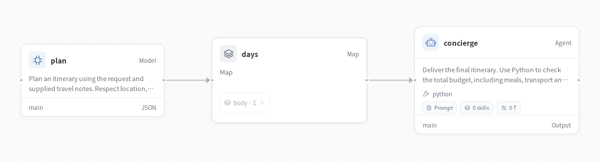

# Travel planner



Build an itinerary around your time, preferences and budget. Plan days in parallel, then check the costs and schedule before delivering the trip.

**Request + travel notes → plan → parallel daily itineraries → budget and schedule review**

## A day out within the budget

**Two adults, a Monday visit, $100 total.** The planner leaves out the museum because it closes on Mondays and offers two options:

| Option | Attractions | Meals | Transport | Total |
| --- | ---: | ---: | ---: | ---: |
| Garden and ferry; walk between stops | $34 | $64 | $0 | **$98** |
| Garden and lakefront; day bus passes | $10 | $64 | $12 | **$86** |

The first leaves $2 for any extra fares. The second includes transport and leaves $14. The assistant flags ferry accessibility and reservations to confirm.

## Try it

Start the [optional Toolbox](../../apps/toolbox/README.md) for Python execution and charts. Its connection is already described in `deployment.example.yaml`. You can replace it with your own service using the same tool contracts.

Configure a model as described in the [quickstart](../../docs/quickstart.md), then run:

```bash
evosprig run examples/travel-planner/agent.yaml \
  --input-file examples/travel-planner/sample.json \
  --profile examples/travel-planner/deployment.example.yaml
```

Open the application in Studio:

```bash
evosprig serve --project examples/travel-planner/agent.yaml \
  --studio-dir apps/studio/dist \
  --profile examples/travel-planner/deployment.example.yaml
```

## Make it yours

Edit `sample.json` for your own task and the files under `prompts/` for the roles and instructions. All coordination, tool calls and parallel work use EvoSprig's AgentSpec and runtime. The [catalog builder](../build_catalog.py) shows how to create the same workflow with the Python SDK.

Use the [evolution guide](../../docs/evolution.md) to improve selected prompts and skills on your own tasks.

Application pattern inspired by [CrewAI’s trip planner](https://github.com/crewAIInc/crewAI-examples); implemented with EvoSprig's own framework.
