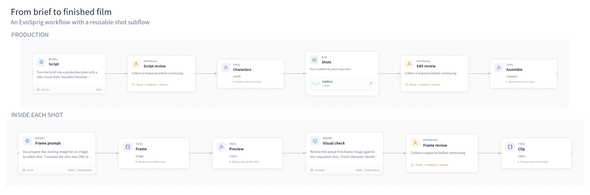
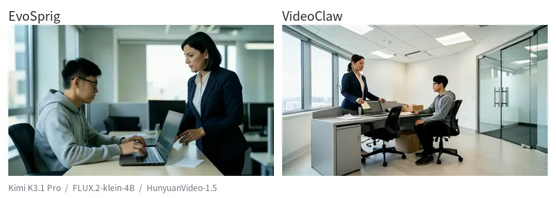
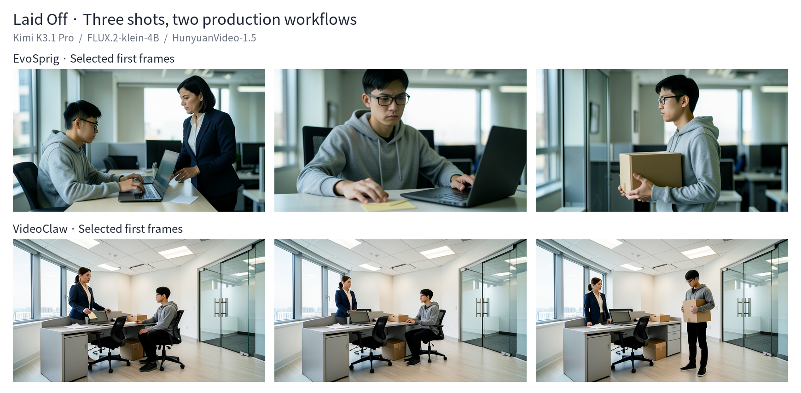
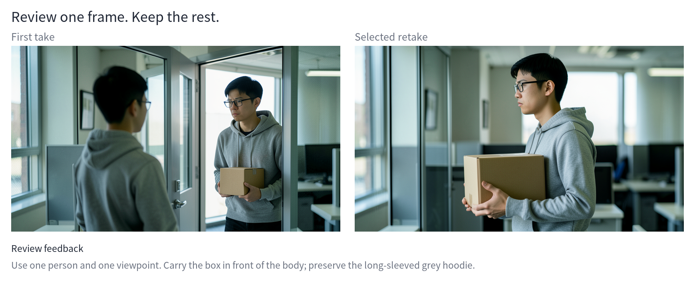

# Video production studio



Turn an idea into a short film with a director, shared character references, visual review and local image/video tools. This application uses EvoSprig's SDK and runtime throughout.

## Watch the result

**Laid Off:** a brief about a programmer receiving an envelope, closing his laptop and leaving with a box. Two reviewed, three-shot productions use the [same brief](brief.json) and the same models.



[Watch EvoSprig's film](assets/evosprig.mp4) · [Watch VideoClaw's film](assets/videoclaw.mp4)

| Shared component | Configuration |
| --- | --- |
| Planning and visual review | Kimi K3.1 Pro |
| Character and first-frame images | FLUX.2-klein-4B, 4 steps |
| Image-to-video | HunyuanVideo-1.5, 480p I2V step-distilled, 12 steps |
| Generation | Seed 42; three 5-second shots; 24 fps; silent |

The story takes its opening premise from [VideoClaw's programmer series](https://github.com/HITsz-TMG/VideoClaw#-创作展示). The second film runs [VideoClaw's own workflow, agents and prompts](https://github.com/HITsz-TMG/VideoClaw/tree/16c1ce0b553e30eff90ff1274e8a8a63c1d548a3), connected through the [shared model adapter](../../apps/media-service/videoclaw.py). Its storyboard was reviewed to select three matching moments; EvoSprig's first frames include reviewed retakes. These are new short productions with common models, rather than a regeneration of the published episode or a quality ranking.



## Make your own film

The local workflow uses **Kimi K3.1 Pro** for planning and visual checks, **FLUX.2-klein-4B** for character and storyboard images, **HunyuanVideo-1.5** to animate approved frames, and **FFmpeg** to assemble the film.

1. The director writes a script and shot list. You review it before rendering.
2. The image tool creates reusable character references.
3. Each shot gets a still-image prompt and first frame. Kimi reads the image and flags problems before your approval.
4. The video tool animates each approved frame. You review the timeline and assemble the selected clips.
5. Retake one frame or shot while keeping the rest of the production.

The shot list runs through a native `map` node. Checkpoints retain completed work and external job receipts when the application restarts.

## Open the studio

Start the [local media worker](../../apps/media-service/) on your GPU machine. Set `MOONSHOT_API_KEY` in the environment, then run:

```bash
evosprig serve --project examples/video-studio/local-agent.yaml \
  --profile examples/video-studio/deployment.local.yaml \
  --studio-dir apps/studio/dist --workspace .evosprig/video
```

Open **http://127.0.0.1:18766**. Paste a brief such as `{"brief":"A librarian discovers a living book. Three silent shots."}` into the run panel and enable writes for media jobs. Review the script, frames and timeline in History; **Show media** opens image previews and video players at each approval step. The [included brief](brief.json) provides a three-shot office scene.

| Project | Use it for |
| --- | --- |
| `local-agent.yaml` | The full workflow with visual frame checks |
| `frame-agent.yaml` | Generate and inspect a replacement first frame |
| `local-shot-agent.yaml` | Generate a replacement shot, with frame approval |
| `compose-agent.yaml` | Assemble selected clips |
| `script-agent.yaml` | Plan and improve stories before rendering |

`build_agent.py` creates these projects with the EvoSprig SDK. To use other generation providers, start from `agent.yaml` and `deployment.example.yaml`.

## Review and retake



The first take showed the programmer twice. Feedback changed the framing to one person in a side view, kept the box in front of his body, and restored the long sleeves. The frame agent rewrote the still-image prompt and generated a replacement; the other frames and production plan stayed available.

Reuse the shot, character catalog and style from History in the frame or shot project. The frame project also accepts `feedback`, such as “Show one person carrying the box in front of his body.” It returns the generated frame, its prompt and the visual review. Select that asset at the production workflow's frame-approval step.

For a new video take, run the shot project and approve its frame. Pass the chosen clips to `compose-agent.yaml` with `audio: []` and `subtitles: ""` for a silent film. The local worker also accepts SRT subtitles.

The director, storyboard and frame-review prompts are ordinary versioned resources. Select them in **Improve** to search for better instructions using your own tasks and evaluation criteria. The script-only project lets you improve the story before spending GPU time on media generation.

## Connect other media tools

| Tool | Input | Output |
| --- | --- | --- |
| `media.assets` | Characters and style | Shared character catalog |
| `media.image` | Shot, catalog, style and optional still-image prompt | First frame |
| `media.vision` | Generated asset | Image content for a vision model |
| `media.video` | Shot and approved first frame | Video clip |
| `media.compose` | Selected clips and subtitles | Film |

Generation tools use the [asynchronous job contract](../../docs/tools.md): submit with an idempotency key, poll the job and receive an asset. The [media worker](../../apps/media-service/) includes these bindings and an optional adapter for running [VideoClaw](https://github.com/HITsz-TMG/VideoClaw) with the same models.
