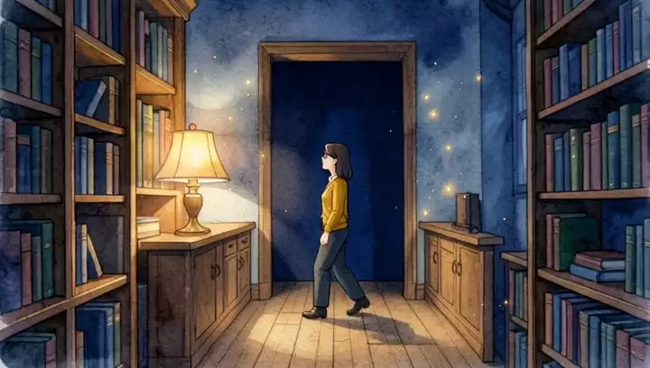
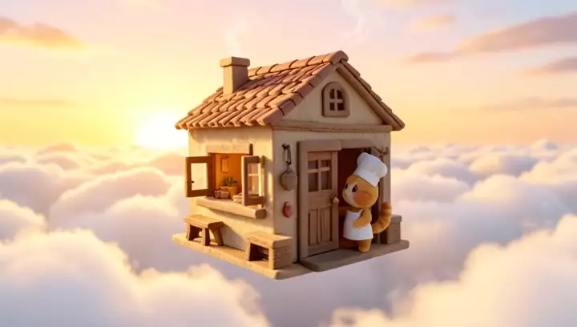
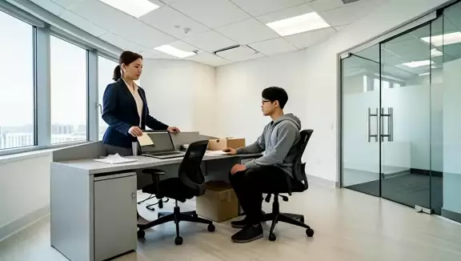

# VideoClaw (EvoSprig)


An EvoSprig reproduction of [VideoClaw](https://github.com/HITsz-TMG/VideoClaw). Turn a story idea into a short film: plan the scenes, create the characters, generate the shots and assemble the cut.

## Short films

<table>
<tr>
<td align="center" valign="top" width="33%"><a href="assets/moon-garden.mp4"></a><br><b>▶ Moon Garden</b><br>A robot grows a garden on the moon.</td>
<td align="center" valign="top" width="33%"><a href="assets/last-library.mp4"></a><br><b>▶ The Last Library</b><br>One book lights up the night.</td>
<td align="center" valign="top" width="33%"><a href="assets/cloud-bakery.mp4"></a><br><b>▶ Cloud Bakery</b><br>A cat opens a bakery in the clouds.</td>
</tr>
</table>

## Make your own film

Start the [media worker](../../apps/media-service/), set `MOONSHOT_API_KEY`, then open the workflow:

```bash
evosprig serve --project examples/video-studio/local-agent.yaml \
  --profile examples/video-studio/deployment.local.yaml \
  --studio-dir apps/studio/dist --workspace .evosprig/video
```

Open **http://127.0.0.1:18766** and submit a brief such as `{"brief":"A librarian discovers a living book. Three silent shots."}`. Enable writes for media jobs. Review the script, frames and timeline in **History**, then assemble the film.

The director plans the story; shared character references connect the shots. A vision model checks each first frame. You can replace a frame or shot and keep the rest of the production. Select the director, storyboard or review prompts in **Improve** to evolve them against your own tasks.

| Project | Purpose |
| --- | --- |
| `local-agent.yaml` | Full production workflow |
| `frame-agent.yaml` | Create a replacement first frame |
| `local-shot-agent.yaml` | Generate one shot |
| `compose-agent.yaml` | Assemble clips and subtitles |
| `script-agent.yaml` | Develop stories before rendering |

The included profile uses Kimi K3.1 Pro, FLUX.2-klein-4B and HunyuanVideo-1.5. These shorts contain three five-second silent shots. To connect other providers, edit the [tool bindings](deployment.example.yaml); the [Python builder](build_agent.py) defines the workflows.

## One brief, two workflows

**Laid Off** — a programmer receives an envelope, closes his laptop and leaves with a box.

<table>
<tr>
<td align="center" width="50%"><a href="assets/evosprig.mp4"></a><br><b>▶ VideoClaw (EvoSprig)</b></td>
<td align="center" width="50%"><a href="assets/videoclaw.mp4"></a><br><b>▶ VideoClaw (Original)</b></td>
</tr>
</table>

[Same brief](brief.json) · [Original VideoClaw workflow](https://github.com/HITsz-TMG/VideoClaw/tree/16c1ce0b553e30eff90ff1274e8a8a63c1d548a3) · [Shared model adapter](../../apps/media-service/videoclaw.py)
