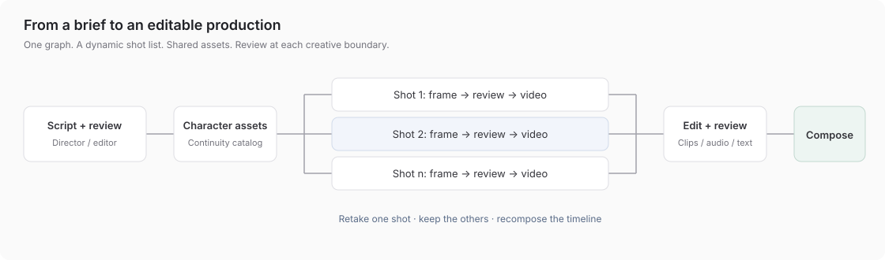

# Video production studio

Build a [VideoClaw](https://github.com/HITsz-TMG/VideoClaw)-style production agent with EvoSprig. The application coordinates creative roles, assets, human reviews and asynchronous media tools.



## From idea to film

1. A director turns your brief into a script, characters and 1–12 shots.
2. You approve the script and the tools create a shared character catalog.
3. EvoSprig creates each shot's first frame, pauses for your approval, then requests its video clip.
4. You choose clip order, audio and subtitles, then submit the timeline for composition.
5. Want another take? Run the shot workflow again and use its new clip in the composition.

The same `map` node used by the research team handles the variable shot list. Completed work and pending media jobs stay in the run history across restarts.

## Open your studio

Configure your model and media service in `deployment.example.yaml`, set the named environment variables, then run:

```bash
evosprig serve --project examples/video-studio/agent.yaml \
  --profile examples/video-studio/deployment.example.yaml \
  --studio-dir apps/studio/dist --workspace .evosprig/video
```

Start a run with `{"brief":"A librarian discovers a living book."}` and enable writes for media jobs. Approve the script, frames and timeline from History. Image/video generation requires connected media tools.

`agent.yaml`, `shot-agent.yaml` and `compose-agent.yaml` are portable projects; `build_agent.py` defines them with the EvoSprig SDK.

## Connect generation tools

Implement the four bindings in `deployment.example.yaml` using your provider SDK or gateway. The orchestrator does not depend on a particular image/video vendor.

| Tool | Input | Output |
| --- | --- | --- |
| `media.assets` | Character descriptions and visual style | Catalog mapping each character ID to a reusable asset |
| `media.image` | Shot, visual style and character catalog | First-frame image asset |
| `media.video` | Shot, approved first frame and catalog | Video clip asset |
| `media.compose` | Ordered clips, audio assets and subtitles | Composed film asset |

Each endpoint follows the shared asynchronous job contract:

```text
POST /<tool>       Idempotency-Key: <operation id>  → {"job_id":"..."}
GET  /<tool>/<id>  → {"status":"pending"}
GET  /<tool>/<id>  → {"status":"succeeded","output":<typed result>}
DELETE /<tool>/<id> → cancel
```

An asset is `{ "id": "...", "uri": "...", "media_type": "image/png|video/mp4|audio/wav" }`. Provider-specific model names, credentials, task IDs and retries belong in the tool service. The service must preserve idempotency and reject a reused key with a different payload. Keep assets addressable across sessions. See [tool contracts](../../docs/tools.md).

VideoClaw supports providers including Wan, Seedance and Kling. This example adapts its staged production pattern; media adapters and generated film quality can be evaluated independently of workflow execution.

## Human review and retakes

Open the main project in Studio with its deployment profile. The History page exposes script, frame and timeline checkpoints. Review outputs are typed JSON; edit them before continuing.

For a retake, run `shot-agent.yaml` with the selected `shot`, existing `catalog` and `style`. Its output contains the new `clip` and `first_frame`. Pass that clip alongside the unchanged clips to `compose-agent.yaml` as `{"clips":[...],"audio":[],"subtitles":""}`. Each run retains its inputs and outputs, including the original production. A changed script or character catalog may require regenerating affected shots.

## Improve the story before rendering

`script-agent.yaml` exposes the same director resource as a standalone planning stage. Try it without a media-service connection:

```bash
evosprig run examples/video-studio/script-agent.yaml \
  --input '{"brief":"A 12-second silent film about a paper boat. Three shots, one recurring character, no text overlays."}'
```

Use that stage to compare and evolve storyboards, then apply the chosen director resource to the production workflow. [Storyboard comparisons](results/README.md) show planning outputs; image/video rendering remains in the tool providers you connect.
