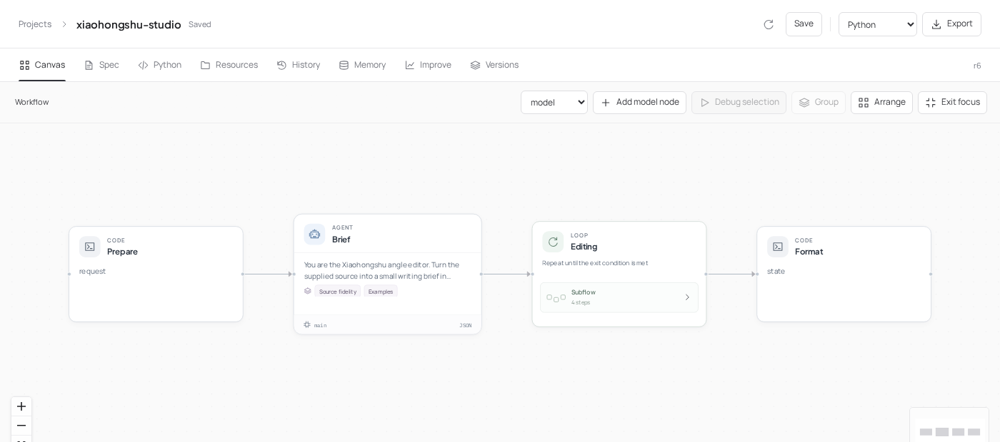
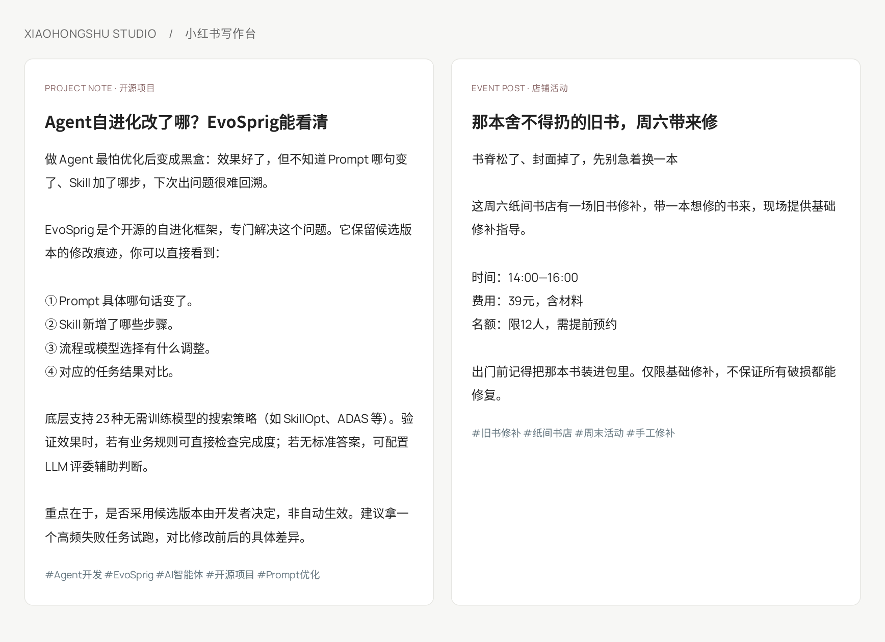

# Xiaohongshu Studio



[English](README.md) · [简体中文](README.zh-CN.md)

**Give it the facts. Get a post worth reading.**

A writing desk for Xiaohongshu: choose an angle, learn from reference posts, draft, check and edit. Bring product notes, an event announcement or a personal story. Adjust the voice and emoji level to fit your account.

## From notes to a post



The bookshop post keeps the fee, booking requirement and limited places together. The project post explains what an agent can change and how a developer checks the result.

## How the team writes

| Step | What happens |
| --- | --- |
| Angle editor | Finds a reader need, extracts facts and chooses a reference pattern |
| Writer | Drafts the title, body and hashtags using shared writing skills |
| Checks | Counts characters, checks required terms and keeps links intact |
| Reader and fact editor | Finds unsupported claims, awkward openings and unclear passages |
| Revision loop | Applies specific feedback, stopping after approval or three drafts |

Style examples teach structure and voice. Facts come from your source. Personal stories keep the experiences you actually supplied. The final `text` is ready to copy; `ready` and `feedback` show whether any editing remains.

## Try it

Configure a compatible model with a [deployment profile](../../docs/deployment.md), then open the workflow:

```bash
evosprig serve --project examples/xiaohongshu-studio/agent.yaml \
  --profile deployment.yaml --studio-dir apps/studio/dist
```

Choose **Live model** and paste [sample.json](sample.json). Only `source` is required. Or run from the terminal:

```bash
evosprig run examples/xiaohongshu-studio/agent.yaml \
  --profile deployment.yaml --input-file examples/xiaohongshu-studio/sample.json
```

| Setting | Choices / default |
| --- | --- |
| `audience`, `goal` | Who the post is for and what it should help them do |
| `voice` | `observer` (default), `brand`, `personal` |
| `emoji` | `none`, `light` (default), `lively` |
| `references` | Up to three posts to use as style references |
| `required_terms`, `links` | Details to retain and URLs to append |
| `max_title_chars`, `max_body_chars` | 24 and 650; configurable character limits |

Open the **Editing** subflow to change the writer or reviewer. Select a node and use **Debug selection** to try it with saved inputs.

## Teach it your account's voice

Edit the [writing skills](skills/) and add your own patterns to the [example library](skills/examples.md). The [Python builder](build_agent.py) defines all roles, checks and revision limits.

In **Improve**, import [task inputs](tasks.jsonl), describe what makes a good post for your readers, and select `draft` and `voice` for optimization. Use a fixed rubric that checks source facts, reader relevance and natural phrasing. Review the candidate's actual posts and resource changes before adopting it. The [search space](search-space.yaml) also exposes writing temperature and the revision limit for harness search. [Evaluation guide](../../docs/evaluation.md).

Writing-interface references: [Xiaohongshu copy generator](https://ai.xiaohongshu.live/zh) and [小加同学](https://agent2048.com/zh/projects/tkqey8km9es0). The included writing examples are original.
