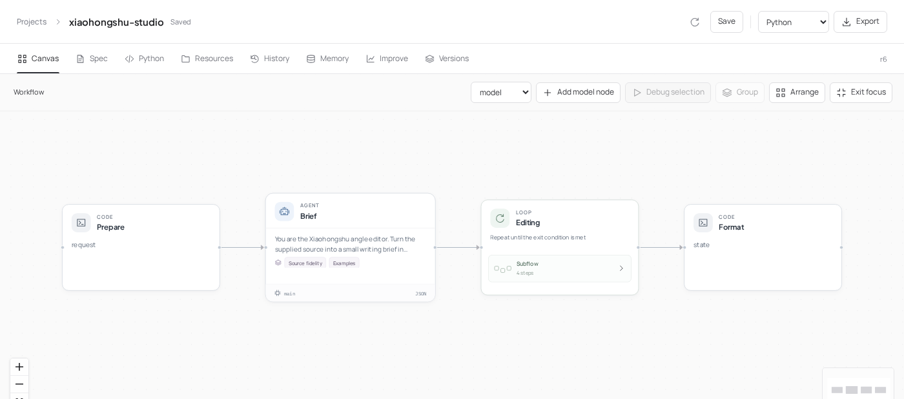
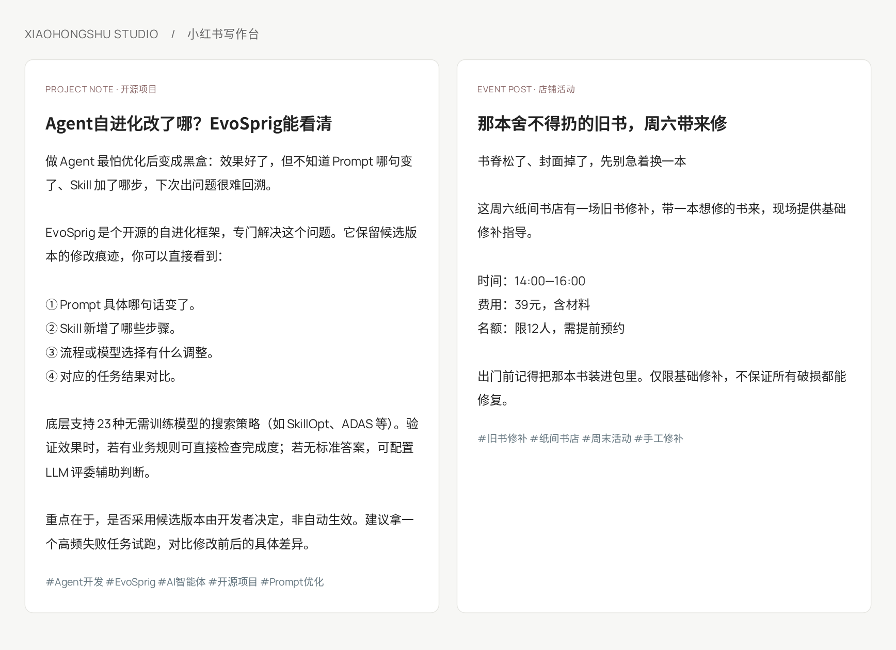

# 小红书写作台



[English](README.md) · 简体中文

**给素材，出一篇读得下去的笔记。**

产品介绍、活动通知、自己的生活记录，都可以交给这张写作台。先找切入点，参考喜欢的文风，再起草、检查和改稿。账号语气、表情多少、哪些信息必须保留，都能调整。

## 从素材到笔记



书店活动把价格、预约要求和名额放在一起；项目介绍说明智能体能改什么，开发者又该怎样判断结果。

## 怎么写出来的

| 环节 | 负责什么 |
| --- | --- |
| 选题编辑 | 找到读者关心的问题，整理事实，选合适的参考写法 |
| 写作者 | 按素材、样例和写作技能生成标题、正文、话题 |
| 代码检查 | 计算字数、检查必留信息，原样保留链接 |
| 读者与事实编辑 | 指出没来源的说法、不顺的开头和不好懂的段落 |
| 改稿循环 | 按具体意见修改，通过后停止，最多写三稿 |

参考笔记用来学习写法，事实取自你提供的素材。个人经历只写素材里发生过的事。结果中的 `text` 可以直接复制；`ready` 和 `feedback` 会告诉你是否还需要修改。

## 开始写

通过[部署配置](../../docs/deployment.md)接入模型，然后打开画布：

```bash
evosprig serve --project examples/xiaohongshu-studio/agent.yaml \
  --profile deployment.yaml --studio-dir apps/studio/dist
```

选择 **真实模型**，粘贴 [sample.json](sample.json)。只有 `source` 必填。也可以从命令行运行：

```bash
evosprig run examples/xiaohongshu-studio/agent.yaml \
  --profile deployment.yaml --input-file examples/xiaohongshu-studio/sample.json
```

| 参数 | 用法 / 默认值 |
| --- | --- |
| `audience`、`goal` | 写给谁，希望帮他了解或完成什么 |
| `voice` | 第三方介绍 `observer`（默认）、品牌口吻 `brand`、个人经历 `personal` |
| `emoji` | 不用 `none`、少量 `light`（默认）、活泼 `lively` |
| `references` | 最多三篇想参考文风的笔记 |
| `required_terms`、`links` | 必须保留的字词、追加到文末的链接 |
| `max_title_chars`、`max_body_chars` | 默认 24 / 650 字符，可调整 |

打开 **Editing** 子流程可以修改写作者和编辑。选择节点，再用 **调试所选** 单独试写或检查。

## 让它学会你的账号风格

修改[写作技能](skills/)，在[样例库](skills/examples.md)补充喜欢的表达方式。[Python 构建器](build_agent.py)定义了角色、检查和改稿上限。

在 **改进** 中导入[任务输入](tasks.jsonl)，写清楚你的读者喜欢什么样的内容，选择 `draft` 和 `voice` 参与优化。评测标准固定检查事实、读者需求和自然程度；查看实际笔记和 prompt、skill 的修改，再决定是否采用。已有[搜索空间](search-space.yaml)也能搜索写作温度和改稿次数。[配置评测](../../docs/evaluation.md)。

交互参考：[小红书文案生成器](https://ai.xiaohongshu.live/zh)、[小加同学](https://agent2048.com/zh/projects/tkqey8km9es0)。内置写作样例为原创。
